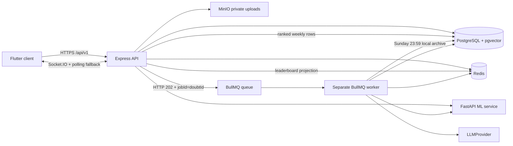

# Architecture

The API owns authentication, validation, synchronous product endpoints, initial doubt requests, and weekly count projection. PostgreSQL stores the distinct question credited per user and week; the Redis sorted set orders the active week and can be rebuilt from those durable rows. The separate worker resolves doubts with the platform's pgvector content and a provider-agnostic LLM interface, and archives the leaderboard on its timezone-based weekly schedule. The Flutter client uses Dio with a secure token store, and receives doubt results over authenticated per-user Socket.IO rooms or status polling. Redis supports short-lived tokens, rate limits, queues, realtime coordination, and leaderboard scores; MinIO stores private user uploads. The Python service owns embeddings and clustering. Flutter remains in the repository root to preserve the pre-existing project setup (see `docs/DECISIONS.md`).

## Phase 1 runtime boundary

The API is split into an application factory and a server entrypoint. Tests inject repository and Redis interfaces. Production startup connects Redis before creating the rate-limit store, then starts the API. `/health` reports process liveness; `/ready` checks PostgreSQL and Redis.
