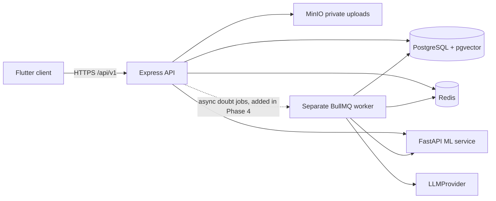

# Architecture

The API owns authentication, validation, and synchronous product endpoints. Content imports and admin edits call the Python service to embed solutions and notes before storing chunks in `note_chunks`; public content routes do not expose answer keys. A later worker process will own long-running doubt resolution and scheduled tasks. PostgreSQL stores product and audit data; Redis supports short-lived tokens, rate limits, queues, and realtime coordination; MinIO stores private user uploads. The Python service owns embeddings and clustering. Flutter remains in the repository root to preserve the pre-existing project setup (see `docs/DECISIONS.md`).

## Phase 1 runtime boundary

The API is split into an application factory and a server entrypoint. Tests inject repository and Redis interfaces. Production startup connects Redis before creating the rate-limit store, then starts the API. `/health` reports process liveness; `/ready` checks PostgreSQL and Redis.
