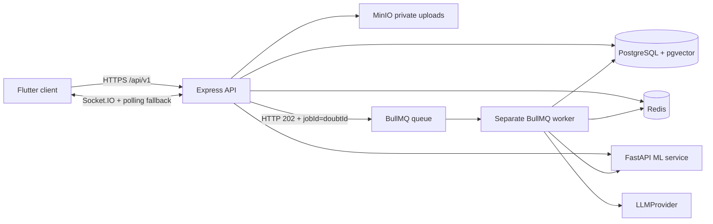

# Architecture

The API owns authentication, validation, synchronous product endpoints, and the initial doubt request. Content imports and admin edits call the Python service to embed solutions and notes before storing chunks in `note_chunks`; public content routes do not expose answer keys. The separate worker resolves doubts with the platform's pgvector content and a provider-agnostic LLM interface. The Flutter client uses Dio with a secure token store, and receives results over authenticated per-user Socket.IO rooms or status polling. PostgreSQL stores product and audit data; Redis supports short-lived tokens, rate limits, queues, and realtime coordination; MinIO stores private user uploads. The Python service owns embeddings and clustering. Flutter remains in the repository root to preserve the pre-existing project setup (see `docs/DECISIONS.md`).

## Phase 1 runtime boundary

The API is split into an application factory and a server entrypoint. Tests inject repository and Redis interfaces. Production startup connects Redis before creating the rate-limit store, then starts the API. `/health` reports process liveness; `/ready` checks PostgreSQL and Redis.
