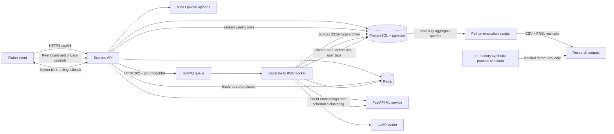

# Architecture

The API owns authentication, validation, synchronous product endpoints, initial doubt requests, weekly count projection, and adaptive practice. PostgreSQL stores the distinct question credited per user and week; the Redis sorted set orders the active week and can be rebuilt from those durable rows. Per-user/topic skill and per-question difficulty estimates and their event history are updated atomically with each attempt. The practice selector prioritizes due resurface rows, then selects by experiment arm. The separate worker resolves doubts with the platform's pgvector content and a provider-agnostic LLM interface, and archives the leaderboard on its timezone-based weekly schedule. The Flutter client uses Dio with a secure token store, and receives doubt results over authenticated per-user Socket.IO rooms or status polling. Redis supports short-lived tokens, rate limits, queues, realtime coordination, and leaderboard scores; MinIO stores private user uploads. The Python service owns embeddings and clustering. Flutter remains in the repository root to preserve the pre-existing project setup (see `docs/DECISIONS.md`).

The authenticated peer board stores threads and replies in PostgreSQL. Account export is read-only and excludes credentials; account deletion removes the user row and cascaded learning records, deletes that user's private S3 objects, revokes existing JWTs, and clears the active leaderboard entry.

Research evaluation queries the PostgreSQL store using a read-only connection and writes aggregate outputs only. Synthetic practice simulation runs in memory, never inserts accounts or attempts, and writes to a separate file explicitly marked as synthetic.

## Phase 1 runtime boundary

The API is split into an application factory and a server entrypoint. Tests inject repository and Redis interfaces. Production startup connects Redis before creating the rate-limit store, then starts the API. `/health` reports process liveness; `/ready` checks PostgreSQL and Redis.
